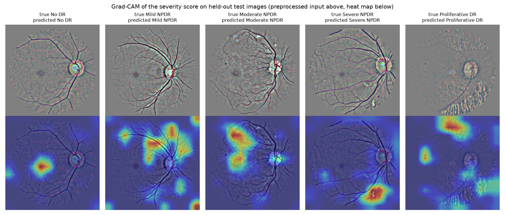
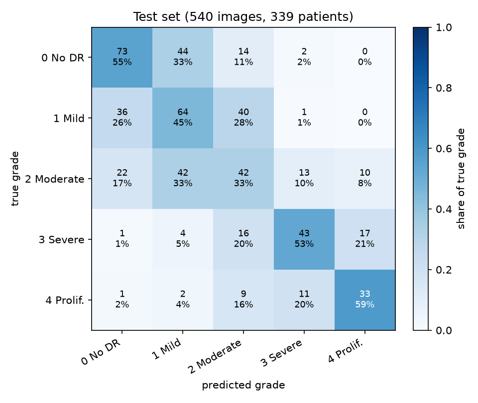
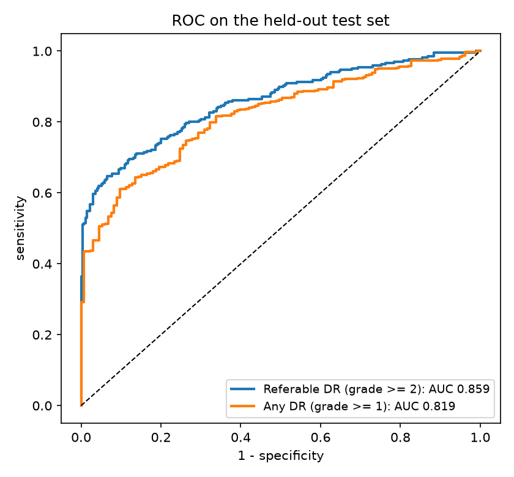
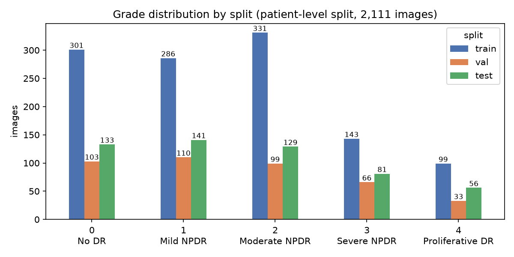
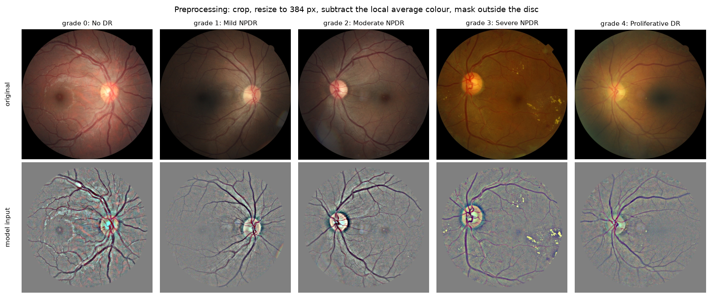
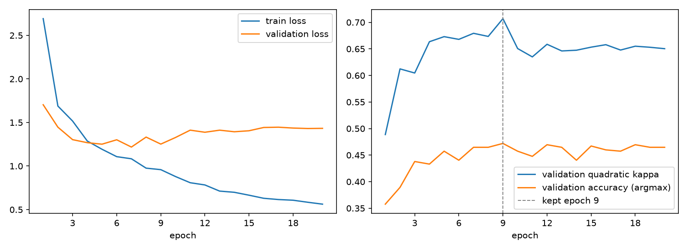
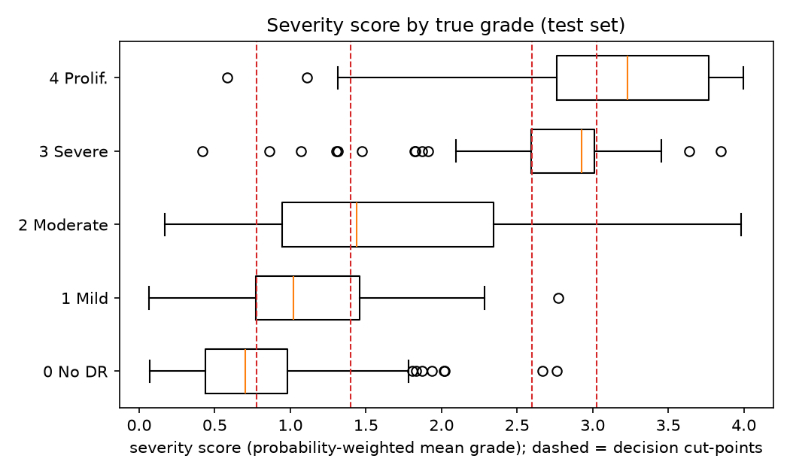

# Diabetic Retinopathy Detection

Grading diabetic retinopathy on the five-level ICDR scale from a single colour fundus photograph, with an
ImageNet-pretrained **EfficientNet-B0** fine-tuned on EyePACS images. The evaluation is built so the numbers can be
trusted:

- a **patient-level** train/validation/test split;
- decision thresholds tuned on validation only;
- patient-bootstrap confidence intervals;
- a frozen-feature baseline for comparison;
- Grad-CAM to show what the model looks at.

A Streamlit app and a command-line tool grade new images.



## Results

Held-out test set: **540 images from 339 patients**. No patient in it appears in training or validation, and it was
not used for model selection or threshold tuning. Test-time augmentation averages the four flips of each image.

| Metric | Test set | 95% CI |
|:--|:--:|:--:|
| Quadratic weighted kappa | **0.710** | 0.652-0.758 |
| Exact grade accuracy (5 classes) | 47.2% | 42.4-52.0% |
| Within one grade | 87.8% | |
| Referable DR (grade ≥ 2): ROC AUC | **0.859** | 0.818-0.897 |
| Referable DR: sensitivity | 72.9% | 66.2-79.2% |
| Referable DR: specificity | 79.2% | 73.5-84.2% |
| Any DR (grade ≥ 1): ROC AUC | 0.819 | |

Against a baseline that trains only a classifier on frozen features of the same backbone, on the same 540 test
images:

| Model | Kappa (95% CI) | Accuracy | Referable sensitivity | Referable specificity |
|:--|:--:|:--:|:--:|:--:|
| Frozen EfficientNet-B0 features + logistic regression | 0.583 (0.502-0.645) | 37.4% | 63.2% | 84.3% |
| **Fine-tuned EfficientNet-B0** | **0.710 (0.652-0.758)** | **47.2%** | 72.9% | 79.2% |
| ... combining both eyes of each patient (see below) | 0.743 (0.689-0.790) | 49.4% | 72.9% | 87.2% |

<p float="left">
  
  
</p>

**What the numbers mean**

- **Fine-tuning drives the gain.** Training the whole network, rather than only a classifier on frozen features, takes kappa from 0.58 to 0.71 and exact accuracy from 37% to 47%.
- **Most errors are between neighbouring grades.** Exact five-grade accuracy is 47%, but 88% of predictions are within one grade. The hardest boundary is between No DR, Mild and Moderate, where the evidence is a handful of microaneurysms a few pixels wide; grade 2 has the lowest recall (33%).
- **Referable DR (grade 2 or worse):** for this screening decision the model reaches an AUC of 0.86. At the kappa-tuned cut-points it finds 73% of referable eyes at 79% specificity; the ROC curve shows the trade-off at other operating points.

For scale, the winning solution of the 2015 Kaggle competition reached a kappa of about 0.85. It trained on roughly 35,000 images (30 times more than here), at higher resolution, and combined both eyes of each patient.

**Using both eyes.** Diabetic retinopathy usually affects both eyes to a similar degree, so the other eye is extra evidence. Each eye's severity score is averaged with its fellow eye's wherever the fellow eye was also photographed. That covers 402 of the 540 test images; the weight (0.5) and new cut-points were chosen on validation. On the full test set:

- kappa rises to **0.743** (95% CI 0.689-0.790);
- referable specificity rises to 87% at the same 73% sensitivity.

The app and the command-line tool grade one image at a time, so the headline numbers above are single-image.

## How it works

### Data

The data is 2,111 EyePACS fundus photographs (1,254 patients) from the [Kaggle Diabetic Retinopathy Detection](https://www.kaggle.com/c/diabetic-retinopathy-detection) training set, each graded 0-4 by a clinician.

The subset came pre-split by image, which put 49 patients' left and right eyes in different splits. [`scripts/make_splits.py`](scripts/make_splits.py) moves those images so that every patient sits in exactly one split. Images are not redistributed here; see [`data/README.md`](data/README.md).



### Preprocessing

Each photograph goes through four steps:

1. crop to the fundus disc;
2. pad to a square and resize to 384 px;
3. normalise with Ben Graham's local-average-colour subtraction (`4·img − 4·GaussianBlur(img) + 128`), the preprocessing from the winning 2015 entry;
4. apply a circular mask that hides the edge of the disc.

Step 3 removes illumination and colour differences between cameras and makes small lesions stand out.



### Model and training

* **Model:** EfficientNet-B0 (`timm`, ImageNet weights) with a new 5-way head and dropout 0.3, 4.0 M parameters.
* **Loss and optimiser:** cross-entropy with label smoothing 0.05; AdamW (learning rate 3e-4, weight decay 0.01); one warm-up epoch, then cosine decay; batch size 16; 20 epochs.
* **Checkpoint:** the epoch with the best validation kappa is kept (epoch 9). After that, the network starts to overfit: training loss keeps falling while validation loss rises.
* **Augmentation:** any rotation, horizontal and vertical flips, small zoom, and mild brightness and contrast jitter.
* **Hardware:** trained on CPU only, on an 8-core laptop. Each epoch takes about 4.6 minutes, using gradient checkpointing to fit in about 3 GB of RAM.



### Turning probabilities into a grade

DR grades are ordered, and a 0 → 4 mistake is far worse than a 1 → 2 one. So the model does not simply take the most likely class:

1. Its five probabilities are collapsed into a **severity score**: the probability-weighted mean grade, from 0 to 4.
2. The score is cut at four thresholds (0.78, 1.40, 2.60, 3.03), tuned on the validation set to maximise quadratic weighted kappa.

On the test set this decoding gives kappa 0.710, against 0.680 for plain argmax.



### Explainability

[`dr/gradcam.py`](dr/gradcam.py) computes Grad-CAM with respect to the severity score rather than a single class logit, so the heat map shows the regions that pushed the predicted severity up.

The examples at the top are one held-out test image per grade, picked at random among correctly graded ones:

- **Severe:** the heat sits on the bright lesions below the disc.
- **No DR:** the model looks at the macula, where early lesions would appear.

The map comes from a 12 x 12 feature grid, so it is a coarse pointer, not a lesion segmentation.

## Quick start

```bash
git clone https://github.com/VinayakMokashi/diabetic-retinopathy-detection.git
cd diabetic-retinopathy-detection
python -m venv .venv
.venv\Scripts\activate          # macOS / Linux: source .venv/bin/activate
pip install -r requirements.txt
```

The trained model ([`models/dr_effnet_b0.pt`](models/dr_effnet_b0.pt), 8 MB) is included, so you can grade images
straight away.

**Command line**

```bash
python scripts/predict.py 12395_left.jpeg 20679_right.jpeg 406_right.jpeg --gradcam outputs/
```

```
12395_left.jpeg: grade 0 (No DR), severity 0.19, P(referable) 0.04 | 0:0.87  1:0.08  2:0.03  3:0.01  4:0.00
20679_right.jpeg: grade 3 (Severe NPDR), severity 2.64, P(referable) 0.99 | 0:0.01  1:0.00  2:0.47  3:0.38  4:0.14
406_right.jpeg: grade 4 (Proliferative DR), severity 3.84, P(referable) 0.98 | 0:0.01  1:0.00  2:0.03  3:0.05  4:0.91
```

These are three held-out test images whose true grades are 0, 2 and 4. The second is graded one step too high: its severity score of 2.64 sits just past the 2.60 cut-point.

**Web app**

```bash
streamlit run app/streamlit_app.py
```

Upload a fundus photograph to see the grade, the probability of referable DR, the preprocessed input and the Grad-CAM overlay.

**Tests**

```bash
pytest
```

## Reproducing the results

```bash
SRC="path/to/Dataset Full/data"      # folders training/ validation/ test/, one sub-folder per grade

python scripts/make_splits.py --source "$SRC"                     # data/splits.csv (already committed)
python scripts/preprocess_images.py --source "$SRC" --size 384    # data/processed/384/
python scripts/make_data_figures.py --source "$SRC"
python scripts/train.py --epochs 20 --grad-checkpointing --out models/dr_effnet_b0.pt
python scripts/baseline_frozen_features.py
python scripts/evaluate.py --checkpoint models/dr_effnet_b0.pt \
    --compare "Frozen EfficientNet-B0 features + logistic regression=reports/baseline_test_predictions.csv"
```

`evaluate.py` writes [`reports/metrics.json`](reports/metrics.json), the per-image test predictions and every figure in this README.

## Repository layout

```
├── app/streamlit_app.py           Streamlit demo
├── data/
│   ├── README.md                  where the images come from and the expected folder layout
│   └── splits.csv                 image → patient, eye, grade, split
├── dr/                            the package
│   ├── preprocessing.py           crop, resize, local-average-colour subtraction, mask
│   ├── data.py                    dataset, augmentations, test-time augmentation
│   ├── model.py                   EfficientNet via timm, checkpoint I/O
│   ├── metrics.py                 kappa, threshold tuning, referable-DR metrics, patient bootstrap
│   ├── gradcam.py                 Grad-CAM of the severity score
│   └── inference.py               Predictor used by the CLI and the app
├── models/dr_effnet_b0.pt(.json)  trained weights + metadata (thresholds, normalisation, validation metrics)
├── reports/                       metrics.json, predictions, training log, figures/
├── scripts/                       splits, preprocessing, training, baseline, evaluation, figures, prediction
├── tests/                         pytest suite (preprocessing, metrics, inference, app)
└── MODEL_CARD.md                  intended use, data, limitations
```

## Limitations

This is a research and portfolio project, **not a medical device**.

- **Small, single-source data:** the model was trained on 1,160 images from one screening programme, with one grader per image.
- **No external validation:** it has not been tested on other cameras or populations.
- **Unrealistic disease mix:** the test set has far more disease than a real screening population. Grade 0 is 25% of it, but about 73% of EyePACS overall.

Next steps that would most improve it:

- more training data (the full 35,000-image EyePACS set);
- a GPU, for higher resolution and longer training;
- an ensemble of several models.

See [MODEL_CARD.md](MODEL_CARD.md) for the full list.

## References

* Gulshan V. et al. Development and validation of a deep learning algorithm for detection of diabetic retinopathy in
  retinal fundus photographs. *JAMA* 316(22), 2016.
* Graham B. Kaggle Diabetic Retinopathy Detection competition report, 2015 (local-average-colour preprocessing).
* Tan M., Le Q. EfficientNet: rethinking model scaling for convolutional neural networks. *ICML* 2019.
* Selvaraju R. R. et al. Grad-CAM: visual explanations from deep networks via gradient-based localization. *ICCV* 2017.
* Wilkinson C. P. et al. Proposed international clinical diabetic retinopathy and diabetic macular edema disease
  severity scales. *Ophthalmology* 110(9), 2003.

## License

Code: MIT ([LICENSE](LICENSE)). The images belong to EyePACS and are subject to the Kaggle competition terms; they
are not included.
